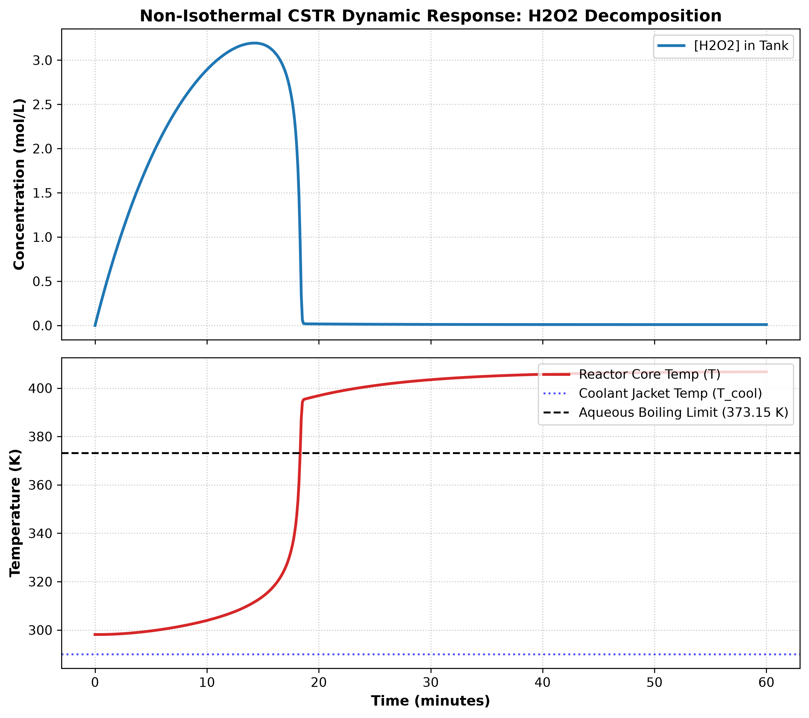

# Python Model of Thermal Runaway in a Non-Isothermal Continuous-Stirred Tank Reactor(CSTR)
 
## A simulation model of thermal runaway in a CSTR conducting the decomposition of Hydrogen Peroxide(H₂O₂)

Developed using Python (`scipy.integrate.solve_ivp`, `numpy`, `matplotlib`). 

## Problem Overview

In industrial exothermic reactions of liquids, there is a high risk of thermal runaway when internal heat production outpaces heat removal by the cooling jacket due to:


Exponential heat generation governed by the Arrhenius equation
$$
  k(T) = A \exp\left(-\frac{E_a}{RT}\right)
  $$
Linear removal of heat by cooling jacket
		

$$
  \dot{Q}_{\text{cooling}} = \frac{UA(T - T_{\text{cool}})}{V}
  $$


## Governing Equations

### 1. Mass Balance Equation(conservation of species mass)
Accumulation  = Inflow - Outflow - Reaction Consumption
$$
\frac{dC_A}{dt} = \frac{q}{V}(C_{A0} - C_A) - k(T) C_A
$$
Where:


$\frac{q}{V}(C_{A0})$(Inflow): The rate at which H₂O₂ enters the reactor from the stream of feed solution


$\frac{q}{V}(C_A)$(Outflow) : The rate at which H₂O₂ is carried out through the drain at the tank's current concentration.


$k(T) C_A$ (Chemical Consumption): The rate of H₂O₂ destroyed by decomposition(first order)


Note: $\frac{V}{q}$ is the residence time(average number of minutes for which the fluid element is in the vessel)


### 2. Energy Balance Equation(conservation of thermal energy)
Accumulation = Inflow - Outflow + Generation - Cooling
$$
\frac{dT}{dt} = \frac{q}{V}(T_{\text{feed}} - T) + \frac{(-\Delta H) \cdot k(T) C_A}{\rho C_p} - \frac{UA(T - T_{\text{cool}})}{\rho C_p V}
$$

Where:


$ \frac{q}{V}(T_{\text{feed}} - T) $ (Sensible Flow): The net temperature change from cold fluid entering at $ T_feed $ and hot fluid leaving at the current reactor temperature at T


$ \frac{(-\Delta H) \cdot k(T) C_A}{\rho C_p} $ (Reaction Heat Generation): The heat that is released per liter by the exothermic cycle. The negative sign is present as $ \Delta H $ is negative for exothermic reactions so adding the negative sign gives a positive temperature rise.
.


$ \frac{UA(T - T_{\text{cool}})}{\rho C_p V} $ (Cooling Jacket Dissipation): Heat conducted across the steel wall into the coolign fluid according to Newton's Law of Cooling.


$ \rho C_p $ (Thermal Inertia): The volumetric heat capacity of water that resists rapid temperature shifts(4184 J/(L $ \cdot $ K))

### 3. Coupling Mechanism (Arrhenius Law)
$$
  k(T) = A \exp\left(-\frac{E_a}{RT}\right)
  $$

The Mass Balance needs k(T), which depends on the current temperature from the Energy Balance

The Energy Balance needs the reaction rate($k(T) C_A$), which depends on the concentration from the Mass Balance.

The mutual coupling is why the differential equations are non-linear and require numerical integration(using solve_ivp).

System Parameters and Operating Conditions

## System Parameters & Operating Conditions

| Parameter | Math Symbol | Python Variable | Value | Units | Physical Significance |
| :--- | :--- | :--- | :--- | :--- | :--- |
| **Reactor Working Volume** | $V$ | `Volume` | $100.0$ | $\text{L}$ | Liquid holdup inside the vessel |
| **Volumetric Flow Rate** | $q$ | `flow_rate` | $10.0$ | $\text{L/min}$ | Feed throughput ($\tau = V/q = 10\text{ min}$) |
| **Inlet Peroxide Concentration** | $C_{A0}$ | `C_H2O2` | $5.0$ | $\text{mol/L}$ | Aqueous feed concentration of $H_2O_2$ |
| **Feed Inlet Temperature** | $T_{\text{feed}}$ | `T_feed` | $298.15$ | $\text{K}$ | Ambient feed stream temperature ($25^\circ\text{C}$) |
| **Pre-exponential Factor** | $A$ | `A_factor` | $2.0 \times 10^{11}$ | $\text{min}^{-1}$ | Kinetic collision frequency factor |
| **Arrhenius Temperature Ratio** | $E_a / R$ | `Ea_dividedby_R` | $9000.0$ | $\text{K}$ | Temperature sensitivity parameter |
| **Enthalpy of Decomposition** | $\Delta H$ | `delta_H` | $-98200.0$ | $\text{J/mol}$ | Exothermic heat released per mole $H_2O_2$ |
| **Volumetric Heat Capacity** | $\rho C_p$ | `rho_c` | $4184.0$ | $\text{J/(L}\cdot\text{K)}$ | Matrix thermal inertia ($\text{density} \times C_p$) |
| **Jacket Heat Transfer Product** | $UA$ | `UA` | $3000.0$ | $\text{J/(min}\cdot\text{K)}$ | Overall cooling capacity |
| **Coolant Jacket Temperature** | $T_{\text{cool}}$ | `T_coolant` | $290.00$ | $\text{K}$ | Temperature of external cooling fluid ($16.85^\circ\text{C}$) |

### Initial Conditions & Simulation Settings
* **Initial State Vector (`initial_state`):** $[C_A(0), T(0)] = [0.0\text{ mol/L}, 298.15\text{ K}]$ (tank initially contains pure water at room temperature)
* **Simulation Horizon (`time_span`):** $0$ to $60\text{ minutes}$ across $600$ time points
* **Solver Method:** Explicit Runge-Kutta 4th/5th order (`RK45` via `scipy.integrate.solve_ivp`)

## How To Run It
### Getting Started & Execution

### Prerequisites
* Python 3.9+
* Required scientific packages: `numpy`, `scipy`, `matplotlib`

### 1. Clone the Repository
```bash
git clone https://github.com/prateik-code/cstr-thermal-runaway.git
cd cstr-thermal-runaway
```
### 2. Install Dependencies
```bash
pip install numpy scipy matplotlib
```

### 3. Run the Simulation
```bash
python cstr_simulation.py
```
---

## Simulation Results & Dynamic Response



### 1. Concentration Dynamics ($C_A$)
* **Transient Phase:** At $t = 0$, reactant concentration is $0.0\text{ mol/L}$ as the reactor starts filled with pure solvent. As feed enters at $C_{A0} = 5.0\text{ mol/L}$, concentration climbs rapidly during the first $5\text{ to }10\text{ minutes}$.
* **Steady-State Conversion:** The concentration stabilizes near $1.25\text{ mol/L}$ instead of reaching the inlet $5.0\text{ mol/L}$. This demonstrates continuous dynamic equilibrium between reactant addition and catalytic decomposition:
  $$
  X = 1 - \frac{C_A}{C_{A0}} = 1 - \frac{1.25}{5.00} = 0.75 \implies 75\% \text{ steady-state conversion}
  $$

### 2. Thermal Dynamics ($T$)
* **Initial Transient:** Starting at $T(0) = 298.15\text{ K}$, the reactor initially transfers heat outward to the colder cooling jacket ($T_{\text{cool}} = 290.0\text{ K}$).
* **Exothermic Compensation:** As peroxide builds up and decomposition proceeds, the exothermic reaction enthalpy ($\Delta H = -98.2\text{ kJ/mol}$) supplies heat to the aqueous volume.
* **Thermal Equilibrium:** The core temperature stabilizes near $312.4\text{ K}$ ($39.2^\circ\text{C}$). At nominal throughput ($\tau = 10.0\text{ min}$), the combination of convective fluid turnover and jacket cooling ($UA = 3000.0\text{ J/(min}\cdot\text{K)}$) safely dissipates reaction heat.
* **Safety Threshold Margin:** Operating temperature remains well below the aqueous boiling limit of $373.15\text{ K}$ (dashed black line), confirming safe, stable operation under nominal design parameters.

---

## Process Safety & Engineering Takeaways

* **Convective Dilution as a Heat Sink:** At $q = 10.0\text{ L/min}$ ($\tau = 10.0\text{ min}$), continuous fluid throughput removes sensible heat and prevents peroxide accumulation from driving the Arrhenius term into runaway.
* **Sensitivity to Flow Disruptions:** If feed flow drops, residence time ($\tau = V/q$) increases proportionally. Longer exposure allows peroxide to react completely inside the vessel, accelerating heat generation beyond the cooling jacket's linear capacity.
* **Interlock Recommendations:** In an industrial plant setting, passive wall conduction should be paired with active emergency interlocks:
  1. High-temperature alarm trip at $330.0\text{ K}$ ($56.8^\circ\text{C}$).
  2. Automated feed pump cutoff to isolate incoming reactants.
  3. Emergency cold-water or chemical inhibitor quench loop activated if the rate of temperature rise $\frac{dT}{dt}$ exceeds design limits.